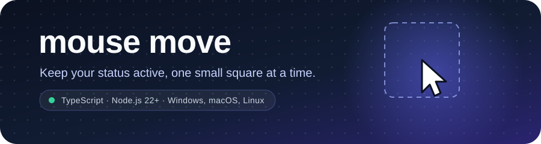
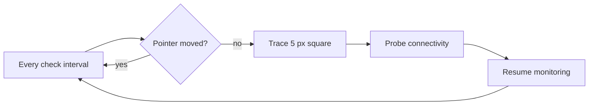

<div align="center">



# Mouse Move

**Keep your status active. Stay available.**

A lightweight TypeScript utility that watches your pointer and nudges it in a small square whenever you go idle, giving collaboration apps a reason to keep you **Available**.

[](https://github.com/blckclov3r/mouse-move/actions/workflows/ci.yml)
[](https://nodejs.org/)
[](https://www.typescriptlang.org/)
[](LICENSE)
[](#-requirements)
[](https://github.com/blckclov3r/mouse-move/stargazers)

Works alongside:

[](https://www.microsoft.com/microsoft-teams)
[](https://slack.com)
[](https://zoom.us)
[](https://chat.google.com)
[](https://discord.com)
[](https://mattermost.com)
[](https://www.rocket.chat)

</div>


---

## 🧭 Table of Contents
- [Requirements](#-requirements)
- [Quick Start](#-quick-start)
- [Why Mouse Move?](#-why-mouse-move)
- [Features](#-features)
- [How It Works](#-how-it-works)
- [Configuration](#-configuration)
- [Scripts](#-scripts)
- [Project Structure](#-project-structure)
- [Development](#-development)
- [Standalone Executables](#-standalone-executables)
- [Continuous Integration](#-continuous-integration)
- [Troubleshooting](#-troubleshooting)
- [Acknowledgments](#-acknowledgments)
- [Disclaimer](#-disclaimer)
- [License](#-license)

## 📋 Requirements

- **Node.js 22 or newer** (`engines.node` is `>=22`)


## 🚀 Quick Start

```sh
# 1. Clone
git clone https://github.com/blckclov3r/mouse-move.git
cd mouse-move

# 2. Install (scripts disabled on purpose — see the note below)
npm install

# 3. Build and run
npm start
```

Stop the app with `Ctrl+C`. The status line clears itself and the process exits with code `0`.

## 💡 Why Mouse Move?

Collaboration tools often switch your presence to **Away** after a period of mouse or keyboard inactivity. Mouse Move polls the pointer, and when it has not moved between two checks, it traces a tiny square (5 px by default) back to where it started. The nudge is small enough to stay out of your way and large enough to register as real input.

## ✨ Features

| Feature | Description |
| --- | --- |
| 🖱️ **Idle detection** | Compares pointer positions between checks instead of guessing from timers. |
| ⬜ **Gentle movement** | Draws and closes a small square so the cursor ends up exactly where it began. |
| 🌐 **Connectivity monitoring** | Probes a random domain from a built-in list and reports connection loss and recovery. |
| ⚙️ **Environment config** | Tune square size, movement speed, and check interval without touching code. |
| 🎨 **Readable output** | A colorized banner, a live single-line status, and clear `INFO` / `ERROR` messages. |
| 🧪 **Tested** | Session and probe logic are covered with Node's built-in test runner and in-memory fakes. |
| 🔒 **Graceful shutdown** | `SIGINT` / `SIGTERM` stop the interval, abort in-flight work, and exit cleanly. |
| 📦 **Packaging script** | Produces standalone Windows and macOS executables with `pkg`. |


### What it looks like

```text
░█████╗░░█████╗░████████╗██╗██╗░░░██╗░█████╗░████████╗███████╗
██╔══██╗██╔══██╗╚══██╔══╝██║██║░░░██║██╔══██╗╚══██╔══╝██╔════╝
███████║██║░░╚═╝░░░██║░░░██║╚██╗░██╔╝███████║░░░██║░░░█████╗░░
██╔══██║██║░░██╗░░░██║░░░██║░╚████╔╝░██╔══██║░░░██║░░░██╔══╝░░
██║░░██║╚█████╔╝░░░██║░░░██║░░╚██╔╝░░██║░░██║░░░██║░░░███████╗
╚═╝░░╚═╝░╚════╝░░░░╚═╝░░░╚═╝░░░╚═╝░░░╚═╝░░╚═╝░░░╚═╝░░░╚══════╝
Start Date: 2026-10-24
Start Time: 9:41:07 AM
linkedIn: @blckclov3r
github: @blckclov3r
mouse-move 09:41:22 Checking connectivity
mouse-move 09:41:22 Network healthy
mouse-move 09:41:37 Idle detected, moving mouse
```

> [!TIP]
> The live status line is written in place and only appears when stdout is a real terminal and `CI` is unset. Redirected output and CI logs contain just the banner plus `INFO` / `ERROR` lines.

## 🔍 How It Works



1. **Startup** — records the current pointer position, prints the banner, and performs the first connectivity probe.
2. **Each check** — reads the pointer again. If it moved, the new position becomes the baseline and nothing else happens.
3. **Idle** — if the position is unchanged, the session traces a square using `MOUSE_SQUARE_SIZE` and waits `MOUSE_MOVEMENT_SPEED` ms between each of the five points, ending where it started.
4. **Connectivity** — in parallel with the movement, up to three attempts hit a random domain from `CONNECTIVITY_URLS` with a 5 second timeout each. Only state *changes* are logged, so a stable connection stays quiet.
5. **Bounded work** — the whole idle operation is raced against a 10 second timeout. If it overruns, the operation is aborted and reported, and monitoring continues.
6. **Shutdown** — `Ctrl+C` (or `SIGTERM`) sets the status to *Shutting down*, clears the status line, aborts in-flight work, and exits.

All status text lives in the `Condition` union in [`src/session.ts`](src/session.ts), and repeated messages are deduplicated before rendering.

## 🔧 Configuration

Configuration is read once, at startup, from environment variables. Invalid numbers silently fall back to their defaults.

| Variable | Description | Default |
| --- | --- | --- |
| `MOUSE_SQUARE_SIZE` | Side length in pixels of the square traced when idle | `5` |
| `MOUSE_MOVEMENT_SPEED` | Delay in milliseconds between each of the five cursor points (lower is faster) | `28` |
| `MOUSE_CHECK_INTERVAL` | Milliseconds between pointer checks | `15000` |

### Examples

**macOS / Linux**

```sh
MOUSE_SQUARE_SIZE=8 MOUSE_CHECK_INTERVAL=30000 npm start
```

**Windows PowerShell**

```powershell
$env:MOUSE_SQUARE_SIZE = "8"
$env:MOUSE_CHECK_INTERVAL = "30000"
npm start
```

**Windows Command Prompt**

```bat
set MOUSE_SQUARE_SIZE=8 && set MOUSE_CHECK_INTERVAL=30000 && npm start
```

> [!TIP]
> Values are cached on first import, so set variables *before* launching the process. To make a setting permanent in PowerShell, use `[Environment]::SetEnvironmentVariable("MOUSE_CHECK_INTERVAL", "30000", "User")` and open a new terminal.

## 🧰 Scripts

| Command | Description |
| --- | --- |
| `npm start` | Builds the project, then launches `dist/index.js`. Runs until stopped. |
| `npm run build` | Removes `dist/`, then compiles `src/` with `tsconfig.build.json` (CommonJS, strict). |
| `npm run clean` | Deletes the generated `dist/` directory. |
| `npm test` | Runs `src/**/*.test.ts` with Node's test runner through `tsx`. |
| `npm run lint` | Lints with ESLint 9 (`eslint.config.js`). |
| `npm run lint:fix` | Applies ESLint's automatic fixes. |
| `npx tsc --noEmit` | Type-checks sources and tests using `tsconfig.json`. |
| `npm run pkg` | Packages `dist/index.js` into standalone executables (see below). |

Run checks in this order — it is the same sequence CI enforces:

```sh
npm run lint && npx tsc --noEmit && npm test
```

## 📁 Project Structure

```text
src/
├── index.ts          # wiring: adapters, session, signal handlers
├── session.ts        # idle detection, square drawing, connectivity, shutdown
├── pointer.ts        # nut-js cursor adapter
├── probe.ts          # fetch-based connectivity probe
├── display.ts        # banner, live status line, colored logs
├── const.ts          # env parsing, palette, connectivity domains
├── session.test.ts   # session tests with fake pointer/probe/display
└── probe.test.ts     # probe tests: empty URL list, abort propagation
```

The session is the deep module: its interface is `createSession(config, {pointer, probe, display})`, returning `{start, stop}`. Everything else is a replaceable adapter, which is what keeps the tests fast and free of native dependencies.

## 🧪 Development

1. Make your change in `src/`.
2. Add or update a `*.test.ts` file next to the code it covers.
3. Verify with `npm run lint`, `npx tsc --noEmit`, and `npm test`.

Notes that save time:

- Tests mock `setInterval` but **not** `setTimeout`; drawing and the idle-operation timeout use real timers, so keep delays small in tests.
- Tests never load `nut-js`; they inject fakes for pointer, probe, and display.
- `Condition` and `SessionEvent` in `src/session.ts` are closed literal unions. Extend the union before emitting a new status or event message, or type-checking fails.
- ESLint 9 reads `eslint.config.js`. The older `.eslintrc.json` is legacy and ignored.
- `npm run build` deliberately excludes tests via `tsconfig.build.json`.

## 📦 Standalone Executables

```sh
npm run build
npm run pkg
```

This writes executables to `./app` — `app-win.exe` and `app-macos` for the current targets.

> [!WARNING]
> The packaging setup has rough edges worth knowing before you ship a binary:
>
> - `npm run pkg` passes `--targets node18-win-x64,node18-macos-x64`, which **overrides** the `node22-*` targets in `package.json`.
> - `pkg` is not a declared dependency; `npx` downloads it on demand.
> - Native `nut-js` files are bundled via the `pkg.assets` glob, but the result must still be smoke-tested on the target OS with desktop access.

## 🔄 Continuous Integration

Every push and pull request to `master` or `main` runs the `verify` job on Ubuntu with Node.js 22:

| Step | Command |
| --- | --- |
| Install | `npm ci --ignore-scripts` |
| Lint | `npm run lint` |
| Typecheck | `npx tsc --noEmit` |
| Test | `npm test` |
| Build | `npm run build` |
| Artifact | Uploads `dist/` for 7 days |

The workflow runs with read-only permissions, cancels superseded runs, sets `CI=true`, and never executes package lifecycle scripts — so the mouse mover cannot start on a runner. See [`.github/workflows/ci.yml`](.github/workflows/ci.yml) and its behavior spec in [`spec/spec-process-cicd-ci.md`](spec/spec-process-cicd-ci.md). Dependabot opens weekly update PRs for npm packages and GitHub Actions.

## 🩺 Troubleshooting

| Symptom | Fix |
| --- | --- |
| Nothing moves on macOS | Grant **Accessibility** permission to your terminal, then restart it. |
| Nothing moves on Linux | Use an X11 session; Wayland often blocks synthetic input. Confirm `DISPLAY` is set. |
| App fails immediately with a permission/display error | It needs a real desktop session — not SSH or a headless container. |
| `npm install` seems to hang and moves your cursor | The `prepare` script launched the app. Re-run with `npm install --ignore-scripts`. |
| Still shown as Away | Presence is app- and policy-controlled. Some tenants disable idle-based presence or use keyboard input only. |
| No live status line | stdout is redirected or `CI` is set; only `INFO` / `ERROR` lines are printed. |
| Cursor drifts near a screen edge | Square coordinates are absolute pixels without bounds clamping, so a square near an edge can fall partly off-screen. |

## 🙏 Acknowledgments

- **[@nut-tree-fork/nut-js](https://github.com/nut-tree/nut.js)** — cross-platform mouse control.
- **[kleur](https://github.com/lukeed/kleur)** — colorized terminal output.
- **[TypeScript](https://www.typescriptlang.org/)** and **[tsx](https://github.com/privatenumber/tsx)** — the build and test toolchain.
- Network checks use the built-in `fetch` API; no ping library required.

## 🚨 Disclaimer

> [!WARNING]
> This project is provided for educational and testing purposes. It generates mouse input that may affect your system or applications, and it does **not** guarantee any particular presence status in Microsoft Teams, Slack, or any other product.
>
> Follow your employer's and organization's policies on automation and presence. Use at your own risk.

## 📄 License

Released under the [MIT License](LICENSE).

Copyright © [blckclov3r](https://github.com/blckclov3r)

> [!NOTE]
> `package.json` still declares `"license": "ISC"`. The `LICENSE` file is MIT and is the authoritative license for this repository.

---

<div align="center">

Made with ☕ and TypeScript

[Report a bug](https://github.com/blckclov3r/mouse-move/issues) · [Request a feature](https://github.com/blckclov3r/mouse-move/issues) · [⭐ Star the repo](https://github.com/blckclov3r/mouse-move)

</div>
