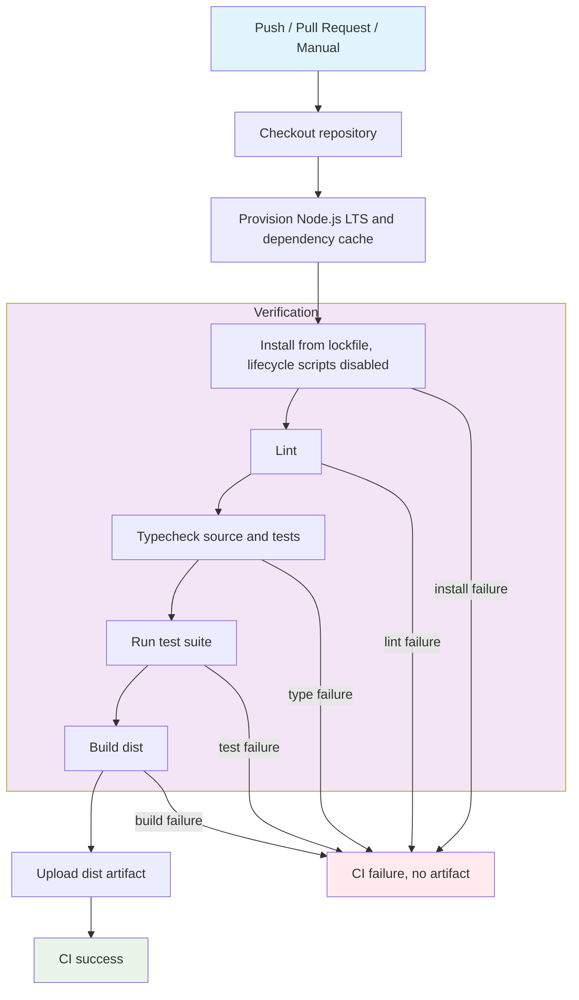

## Workflow Overview

**Purpose**: Verify every change with lint, typecheck, tests, and a production build, then publish the compiled `dist/` output as a short-lived artifact.
**Trigger Events**: Push to `master` or `main`; pull request targeting `master` or `main`; manual dispatch.
**Target Environments**: GitHub-hosted Ubuntu runner and GitHub Actions artifact storage. No deployment environment is targeted.

## Execution Flow Diagram



## Jobs & Dependencies

| Job Name | Purpose | Dependencies | Execution Context |
|----------|---------|--------------|-------------------|
| verify | Run all quality gates and produce the build artifact | None | GitHub-hosted Ubuntu runner, Node.js 22 LTS |

## Requirements Matrix

### Functional Requirements

| ID | Requirement | Priority | Acceptance Criteria |
|----|-------------|----------|-------------------|
| REQ-001 | Verify pushes and pull requests to the default branches | High | Workflow run appears for each matching push and PR |
| REQ-002 | Allow maintainers to run verification on demand | Medium | Manual dispatch starts the same job and gates |
| REQ-003 | Install dependencies exactly from the lockfile | High | Install fails when the lockfile and manifest disagree |
| REQ-004 | Disable dependency lifecycle scripts during install | High | The application's `prepare` script cannot launch the long-running mouse process in CI |
| REQ-005 | Enforce zero lint errors | High | Job stops at the lint gate on any lint error |
| REQ-006 | Typecheck sources and test files | High | Job stops on any TypeScript diagnostic |
| REQ-007 | Execute the full automated test suite | High | Job fails if any test fails or the runner reports an error |
| REQ-008 | Produce a clean compiled build | High | `dist/` is regenerated after removing previous output |
| REQ-009 | Publish the build as a downloadable artifact | Medium | Successful run exposes a `dist` artifact retained for 7 days |
| REQ-010 | Stop subsequent gates after the first failure | High | No artifact is uploaded when any prior gate fails |

### Security Requirements

| ID | Requirement | Implementation Constraint |
|----|-------------|---------------------------|
| SEC-001 | Use least-privilege repository access | Workflow token limited to read-only repository contents |
| SEC-002 | Avoid stored credentials in CI | No repository secrets are referenced by the workflow |
| SEC-003 | Prevent credential persistence in the checkout | Checkout does not leave the workflow token in Git configuration |
| SEC-004 | Prevent arbitrary install-time execution | Dependency lifecycle scripts remain disabled |
| SEC-005 | Prefer immutable third-party action references | Pin actions to full commit SHAs when the supply-chain policy is adopted |
| SEC-006 | Treat pull requests from forks as untrusted | Read-only token and no secrets; pull request code still passes all gates |

### Performance Requirements

| ID | Metric | Target | Measurement Method |
|----|-------|--------|-------------------|
| PERF-001 | End-to-end verification duration | ≤ 10 minutes | Workflow run duration |
| PERF-002 | Dependency install duration | Cache hit on repeat runs | Setup step cache status |
| PERF-003 | Redundant run avoidance | Superseded runs on the same ref are cancelled | Concurrency group behavior |
| PERF-004 | Artifact retention | 7 days | Artifact metadata |

## Input/Output Contracts

### Inputs

```yaml
# Environment Variables
CI: "true"  # Purpose: force non-interactive output in tools that inspect CI

# Repository Triggers
branches: [master, main]
events: [push, pull_request, workflow_dispatch]
paths: all paths  # Documentation-only changes also run the full workflow

# Toolchain
node: LTS (22.x)  # Purpose: runtime for lint, typecheck, tests, and build
package_manager: npm with committed lockfile
```

### Outputs

```yaml
# Job Outputs
job_status: success | failure  # Purpose: merge gate result
build_artifact: dist/          # Content: compiled JavaScript, declarations, and source maps
artifact_name: dist
artifact_retention: 7 days
```

### Secrets & Variables

| Type | Name | Purpose | Scope |
|------|------|---------|-------|
| Token | `GITHUB_TOKEN` | Read repository contents | Workflow, read-only |
| Variable | `CI` | Non-interactive execution | Workflow |
| Secret | None | No secret is required | Not applicable |

## Execution Constraints

### Runtime Constraints

- **Timeout**: 10 minutes for the verification job.
- **Concurrency**: One active run per workflow and Git ref; newer runs cancel older runs.
- **Resource Limits**: Standard GitHub-hosted Ubuntu runner; no custom hardware.

### Environmental Constraints

- **Runner Requirements**: Linux, Node.js 22 LTS (the manifest requires `>=22`), npm with lockfile support.
- **Network Access**: npm registry during install; GitHub APIs for checkout and artifact upload.
- **Permissions**: Read-only repository contents; artifact upload through the workflow token.
- **Desktop Access**: None. Tests use in-memory pointer, probe, and display adapters; native mouse access is neither required nor exercised.

## Error Handling Strategy

| Error Type | Response | Recovery Action |
|------------|----------|-----------------|
| Dependency install failure | Fail job before any gate; upload no artifact | Verify lockfile and registry availability, then rerun |
| Lint failure | Fail job; later gates do not run | Fix lint errors locally and push |
| Typecheck failure | Fail job; tests and build do not run | Fix TypeScript diagnostics and push |
| Test failure | Fail job; build and artifact upload do not run | Reproduce with the documented test command, fix, and push |
| Build failure | Fail job; no artifact | Reproduce the build locally, fix compilation, and push |
| Artifact upload failure | Fail job after a successful build | Rerun the job; investigate artifact service status if persistent |
| Cancelled run | Mark run cancelled; no artifact expected | Start a fresh run after the newer change settles |
| Fork pull request | Run with read-only token and no secrets | Same gates; maintainer reviews the result |

## Quality Gates

### Gate Definitions

| Gate | Criteria | Bypass Conditions |
|------|----------|-------------------|
| Code quality | Zero lint errors | None |
| Type safety | Zero TypeScript diagnostics | None |
| Tests | All tests pass | None |
| Build | Clean build produces `dist/` | None |
| Artifact | `dist` uploaded after all gates pass | Not uploaded on failure |

## Monitoring & Observability

### Key Metrics

- **Success Rate**: ≥ 95% of runs on the default branch; investigate repeated failures.
- **Execution Time**: ≤ 10 minutes; use a cache hit for dependency installation.
- **Resource Usage**: Standard runner only; no custom monitoring.

### Alerting

| Condition | Severity | Notification Target |
|-----------|----------|-------------------|
| Default-branch run fails | High | GitHub notifications and repository watchers |
| Repeated install failures | Medium | Maintainers |
| Run approaches timeout | Low | Maintainers |

## Integration Points

### External Systems

| System | Integration Type | Data Exchange | SLA Requirements |
|--------|------------------|---------------|------------------|
| npm registry | Dependency download | Package tarballs and metadata | Available during install; failure fails the job |
| GitHub Actions | Orchestration | Workflow events, logs, status | Standard GitHub availability |
| Artifact storage | Build publication | `dist/` archive | 7-day retention |
| Dependabot | Dependency update automation | Weekly npm and GitHub Actions pull requests | Update pull requests run this workflow |

### Dependent Workflows

| Workflow | Relationship | Trigger Mechanism |
|----------|--------------|-------------------|
| Deployment | None currently | No deployment workflow exists |
| Dependency updates | Adopted via Dependabot | Weekly schedule opens npm and GitHub Actions update pull requests |

## Compliance & Governance

### Audit Requirements

- **Execution Logs**: Retained according to repository and organization GitHub settings; default is 90 days.
- **Approval Gates**: None inside the workflow; branch protection is recommended to require this check before merge.
- **Change Control**: Update this specification before changing the workflow's behavior.

### Security Controls

- **Access Control**: Read-only workflow token; no write scopes.
- **Secret Management**: No secrets used.
- **Vulnerability Scanning**: Dependabot update pull requests are enabled; this workflow does not run a blocking dependency audit.

## Operational Recommendations

| Recommendation | Status | Rationale |
|----------------|--------|-----------|
| Require this workflow as a branch protection check | Recommended (repository setting) | Prevents merging changes that fail lint, types, tests, or build |
| Enable Dependabot for npm and GitHub Actions | Adopted (`.github/dependabot.yml`) | Keeps dependencies and action versions current |
| Pin third-party actions to full commit SHAs | Recommended (hardening) | Reduces supply-chain risk from mutable tags |
| Add path filters for documentation-only changes | Optional | Reduces noise while keeping code changes fully verified |
| Add a coverage report | Optional | The current suite has no coverage tool; add only with a defined threshold |
| Add `engines.node` to the manifest | Optional | Makes the supported Node.js range explicit |
| Add a dependency audit gate | Deferred | Existing moderate advisories need review before making the gate blocking |

## Edge Cases & Exceptions

### Scenario Matrix

| Scenario | Expected Behavior | Validation Method |
|----------|-------------------|-------------------|
| Documentation-only change | Full workflow runs; no special path filter | Inspect trigger result |
| Pull request from a fork | Read-only token, no secrets, all gates run | Check workflow permissions and logs |
| Lockfile out of sync | Install fails; no later gates run | Introduce a temporary mismatch in a branch |
| Dependency cache miss | Install from registry; workflow still succeeds within timeout | Clear cache and rerun |
| `prepare` script present | Not executed during install | Confirm no long-running process starts in the install step |
| Native mouse dependency unavailable headless | No effect; tests never load the native pointer adapter | Run the suite on Linux |
| Superseded push | Older run is cancelled; newer run reports the final status | Push twice in quick succession |
| Manual dispatch on a branch | Same gates and artifact behavior as a push | Use the manual trigger |

## Validation Criteria

### Workflow Validation

- **VLD-001**: Workflow YAML parses and is accepted by GitHub Actions.
- **VLD-002**: Push, pull request, and manual triggers all start the `verify` job.
- **VLD-003**: The install step does not execute project lifecycle scripts.
- **VLD-004**: Lint, typecheck, tests, and build run in that order.
- **VLD-005**: A successful run exposes the `dist` artifact; a failed run does not.
- **VLD-006**: The workflow token has read-only repository permissions.
- **VLD-007**: No secret is referenced anywhere in the workflow.
- **VLD-008**: A superseded run on the same ref is cancelled.

### Performance Benchmarks

- **PERF-001**: A cache-hit run completes in under 10 minutes.
- **PERF-002**: Repeated runs reuse the npm dependency cache.
- **PERF-003**: The artifact is retained for exactly 7 days.

## Change Management

### Update Process

1. **Specification Update**: Modify this document first for behavior changes.
2. **Review & Approval**: Open a pull request and require a maintainer review.
3. **Implementation**: Update the workflow to match this specification.
4. **Testing**: Validate on a feature branch and confirm all gates and the artifact.
5. **Deployment**: Merge after the required check passes.

### Version History

| Version | Date | Changes | Author |
|---------|------|---------|--------|
| 1.0 | 2026-10-23 | Initial specification; CI with lint, typecheck, tests, build, and artifact upload | DevOps Team |
| 1.1 | 2026-10-23 | Adopt Dependabot for npm and GitHub Actions; document the Node.js 22 engine contract | DevOps Team |

## Related Specifications

- [Repository agent guidance](../AGENTS.md)
- [Domain glossary](../GLOSSARY.md)
- Deployment specification: not yet defined; add one before introducing a deployment workflow.
